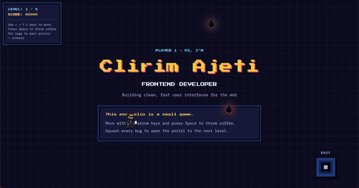

<h1 align="center">portfolio-game</h1>

<h3 align="center">My developer portfolio, as a small retro game.</h3>

<p align="center">
  <a href="https://game.clirimajeti.com"><strong>Play it at game.clirimajeti.com</strong></a>
</p>

<p align="center">
  <a href="https://game.clirimajeti.com"></a>
</p>

Walk through five levels (Intro, About, Skills, Projects, Contact), throw coffee at the bugs, and squash every bug to open the portal to the next level.

## Controls

| Key | Action |
|---|---|
| Arrow keys | Move |
| Space | Throw coffee |
| ~ | Open the console |

## Built with

Vue 3, TypeScript, Pinia and Vite, tested with Vitest, deployed on Vercel.

## Run it locally

```bash
npm install
npm run dev
```

| Command | What it does |
|---|---|
| `npm run build` | Type-checks and builds into `dist/` |
| `npx vitest run` | Runs the unit tests once |
| `npm run lint` | Lints and fixes with ESLint |

Content (about text, skills, projects) lives in `src/constants/index.ts`.
